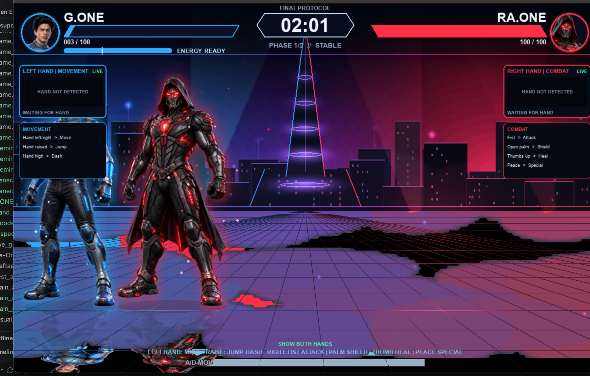
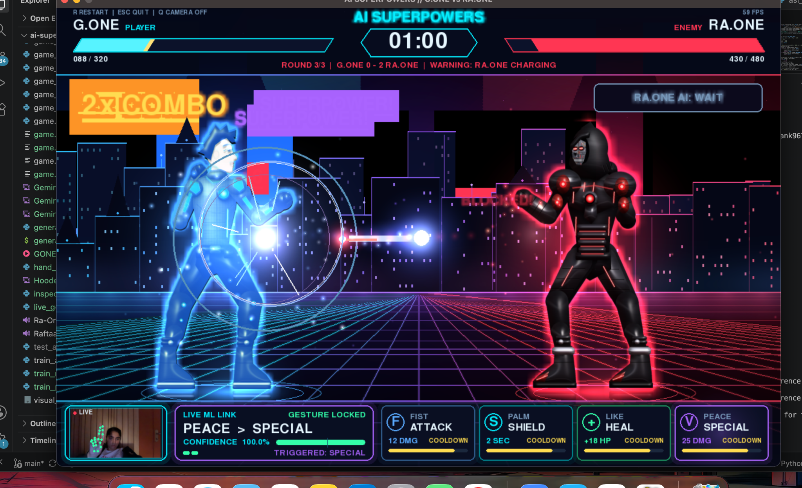
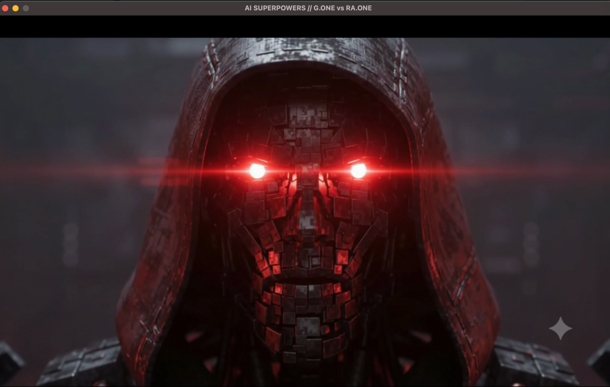
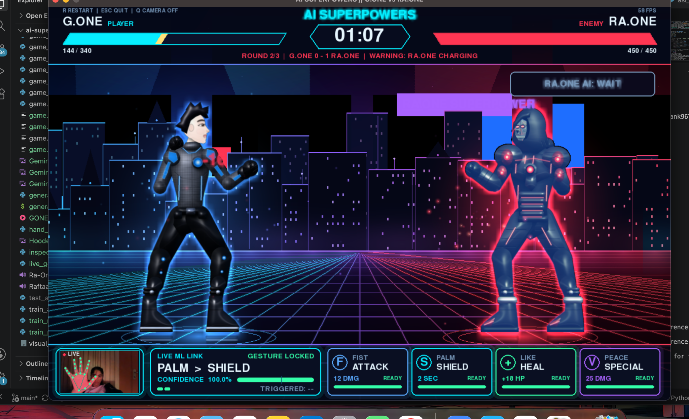
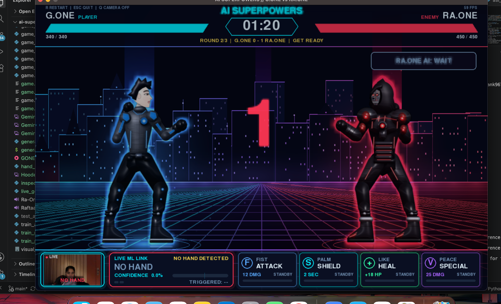

# ⚡ AI SUPERPOWERS
### G.ONE vs RA.ONE — An AI-Powered Gesture-Controlled Fighting Game

<p align="center">
  
  
  
  
  
</p>

<p align="center">
  <strong>CONTROL THE BATTLE. MASTER YOUR GESTURES. FACE THE AI.</strong>
</p>

---

## 🎮 THE GAME

**AI SUPERPOWERS** is an interactive superhero fighting game that brings together real-time hand gesture recognition, computer vision, and reinforcement learning.

Step into the battle as **G.ONE** and face **RA.ONE**, an AI-powered opponent that uses a hybrid combat intelligence system combining a trained PPO policy with tactical decision-making.

Forget traditional button-only gameplay. Use your webcam and hand gestures to attack, defend, heal, and unleash special abilities.

And when you think the battle is over, prepare for the **FINAL PROTOCOL**.

---

## 🖥️ GAMEPLAY SHOWCASE

<p align="center">
  
  <br/>
  <em>FINAL PROTOCOL — The ultimate G.ONE vs RA.ONE confrontation.</em>
</p>

### ⚔️ The Battle Arena

<p align="center">
  
</p>

### 🔴 Cinematic RA.ONE Reveal

<p align="center">
  
</p>

### ✋ Real-Time Gesture Recognition

<p align="center">
  
</p>

### 🏆 Dynamic Round Progression

<p align="center">
  
</p>

---

## 🔥 KEY FEATURES

### 01 — 🖐️ Real-Time Gesture Controls

Control G.ONE using your webcam.

| Hand Gesture | In-Game Action |
|---|---|
| Fist | Attack |
| Open Palm | Shield |
| Thumbs Up | Heal |
| Peace Sign | Special Attack |
| Hand Movement | Character Movement |
| Raised Hand | Jump |

- MediaPipe-based hand tracking.
- OpenCV webcam processing.
- Random Forest gesture classification.
- Live gesture confidence and recognition feedback.

### 02 — 🤖 AI-Powered RA.ONE

RA.ONE is more than a scripted opponent.

- PPO-based reinforcement learning.
- Stable-Baselines3 integration.
- Hybrid AI combining PPO decisions and tactical combat priorities.
- Scripted fallback when a trained checkpoint is unavailable.

### 03 — ⚡ Dynamic Combat Mechanics

- Health and energy management.
- Attack and special attack mechanics.
- Shield and healing abilities.
- Combat effects and visual feedback.
- Multi-round battle progression.

### 04 — 🎬 Cinematic Experience

- Custom G.ONE and RA.ONE character visuals.
- Animated battle environments.
- Hacked-screen transitions.
- Cinematic video sequences.
- Custom background music, sound effects, and voice assets.

### 05 — 👑 FINAL PROTOCOL

An additional boss-battle experience featuring:

- Multiple playable fighter options.
- Dedicated combat mechanics.
- RA.ONE AI integration.
- Custom visuals and cinematic presentation.

---

## 🧠 AI ARCHITECTURE

The project integrates computer vision, machine learning, and reinforcement learning into one interactive application.

| System | Technology | Responsibility |
|---|---|---|
| Hand tracking | MediaPipe | Extract hand landmarks |
| Frame processing | OpenCV | Process webcam input |
| Gesture recognition | Random Forest | Classify player gestures |
| Opponent intelligence | PPO | AI combat decisions |
| Tactical controller | Python | Combat priorities and overrides |
| Game engine | Pygame | Rendering and gameplay |

### How It Works

```text
       WEBCAM INPUT
             |
             v
     MEDIAPIPE HAND TRACKING
             |
             v
      HAND LANDMARKS
             |
             v
    RANDOM FOREST CLASSIFIER
             |
             v
      GESTURE RECOGNITION
             |
             v
       PLAYER ACTIONS
             |
             v
       PYGAME BATTLE
             |
             |
       RA.ONE AI SYSTEM
             |
             v
      PPO + TACTICAL LOGIC
             |
             v
      OPPONENT DECISIONS
```

---

## 🛠️ TECHNOLOGY STACK

<p align="center">
  
</p>

| Category | Technologies |
|---|---|
| Programming | Python |
| Game Development | Pygame |
| Computer Vision | OpenCV, MediaPipe |
| Machine Learning | Scikit-learn, NumPy, Joblib |
| Reinforcement Learning | Stable-Baselines3, PPO |
| Deep Learning Framework | PyTorch |

---

## 📂 PROJECT STRUCTURE

```text
AI-Superpowers/
│
├── game.py
├── final_protocol.py
├── cinematic_video.py
│
├── models/
│   └── gesture_model.pkl
│
├── characters/
│   ├── gone.png
│   ├── gone1.png
│   ├── raone.png
│   ├── raone1.png
│   └── ...
│
├── assets/
│   ├── raone_voice/
│   └── result_audio/
│
├── raone_ppo_starter 2/
│   └── models/
│       └── aggressive/
│           └── best/
│               └── best_model.zip
│
├── screenshots/
│   ├── final-protocol.png
│   ├── gameplay-combat.png
│   ├── raone-cinematic.png
│   ├── gesture-shield.png
│   └── round-progression.png
│
├── after_hack_screen.mp4
├── after_video1.mp4
├── coub-yj2bc.mp4
├── coub-vj2bc.mp4
│
├── requirements.txt
└── README.md
```

---

## ⚙️ INSTALLATION & EXECUTION

### 1. Clone the repository

```bash
git clone https://github.com/Simrank967/AI-Superpowers.git
cd AI-Superpowers
```

### 2. Create a virtual environment

```bash
python3.11 -m venv .venv
source .venv/bin/activate
```

### 3. Install dependencies

```bash
pip install pygame opencv-python mediapipe numpy scikit-learn joblib stable-baselines3
```

### 4. Launch the game

```bash
python game.py
```

### Requirements

- Python 3.11 recommended.
- Webcam access.
- Required game assets and model checkpoints.
- Compatible local audio/video playback support.

---

## 🚀 WHAT MAKES THIS PROJECT DIFFERENT?

- **Human–AI interaction:** Replaces conventional button-only interaction with webcam-based gestures.
- **Integrated intelligence:** Combines supervised gesture classification with reinforcement learning.
- **Hybrid opponent:** Uses learned PPO decisions alongside tactical combat logic.
- **Immersive presentation:** Custom characters, cinematic sequences, audio, and a multi-stage battle experience.
- **End-to-end development:** Integrates AI models, computer vision, game logic, and real-time rendering into one application.

---

## 👩‍💻 DEVELOPER

**Simran Kaur**

Electronics and Computer Engineering  
Thapar Institute of Engineering and Technology

[](https://github.com/Simrank967)

---

<p align="center">
  <h2 align="center">⚡ ONE GAME. TWO SUPERPOWERS. ONE EPIC BATTLE. ⚡</h2>
  <p align="center"><em>Built with Python, AI, computer vision, and a love for gaming.</em></p>
</p>
